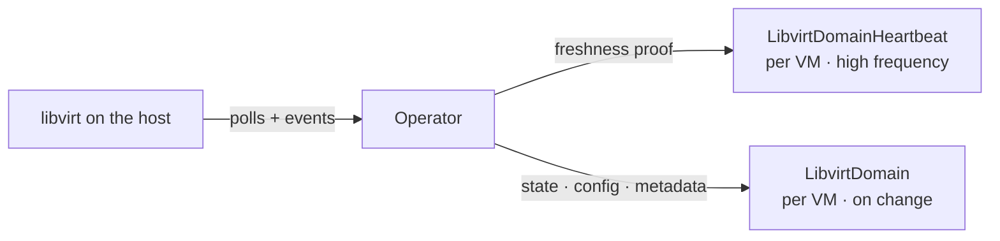

<!--
SPDX-FileCopyrightText: 2026 cobaltcore-dev contributors

SPDX-License-Identifier: Apache-2.0
-->

# Libvirt-Kubernetes-Exporter

When something goes wrong with a VM, the most reliable answer has always been to SSH onto the host and ask libvirt directly. This operator makes that answer available in Kubernetes. Once deployed, every host's VM state is queryable from your kubernetes cluster.



## Quick Start

**No Kubernetes needed — run the demo locally:**

```bash
cd integration/cmd/demo
go run . --webui-dir ../../../dev/webui
# Open http://localhost:8000
```

This spins up a fake libvirt, a fake Kubernetes API, and the operator all in one process, with a web UI to inspect what's happening.

**Run in a real cluster (kind + Tilt):**

Prerequisites: `kubectl`, `tilt`, and a local cluster — the setup uses `kind` but any local Kubernetes cluster works.

```bash
kind create cluster --name libvirt-dev
tilt up
```

Tilt starts a fake libvirt on your machine, builds and loads the operator into kind, and hot-reloads it on every Go file change. See [`dev/tilt-setup/README.md`](dev/tilt-setup/README.md) for how to inspect CRDs and manage fake VMs while it's running.

## Features

- **Real VM state** — reads directly from libvirt on each host, combining event-driven updates with periodic polling so nothing is missed
- **Two custom resources per VM** — a lightweight heartbeat (updated frequently, proves the operator is alive and observing) and a full data record (VM config, state, memory, vCPU count, Nova metadata)
- **Timestamped observations** — every value carries when it was queried and when the state was observed, so consumers know exactly how fresh the data is
- **Handles disappearing VMs** — extended states (`unknown`, `hanging`, `gone`) cover failure modes that libvirt's own state codes don't: socket failures, timeouts, and VMs that were observed and then vanished
- **Migration detection** — detects active live migrations and records whether the host is the source or destination, so you can tell at a glance which VMs are in flight
- **Nova metadata as labels** — project, user, flavor, and instance name are surfaced as Kubernetes labels for easy filtering with `kubectl`

## Documentation

Read the full documentation at [docs/README.md](docs/README.md).

## Support, Feedback, Contributing

This project is open to feature requests/suggestions, bug reports etc. via [GitHub issues](https://github.com/cobaltcore-dev/libvirt-kubernetes-exporter/issues). Contribution and feedback are encouraged and always welcome. For more information about how to contribute, the project structure, as well as additional contribution information, see our [Contribution Guidelines](CONTRIBUTING.md).

## Security / Disclosure

If you find any bug that may be a security problem, please follow our instructions at [in our security policy](https://github.com/cobaltcore-dev/libvirt-kubernetes-exporter/security/policy) on how to report it. Please do not create GitHub issues for security-related doubts or problems.

## Code of Conduct

We as members, contributors, and leaders pledge to make participation in our community a harassment-free experience for everyone. By participating in this project, you agree to abide by its [Code of Conduct](https://github.com/SAP/.github/blob/main/CODE_OF_CONDUCT.md) at all times.

## Licensing

Please see our [LICENSE](LICENSE) for copyright and license information. Detailed information including third-party components and their licensing/copyright information is available [via the REUSE tool](https://api.reuse.software/info/github.com/cobaltcore-dev/libvirt-kubernetes-exporter).

<p align="center">
  
</p>
